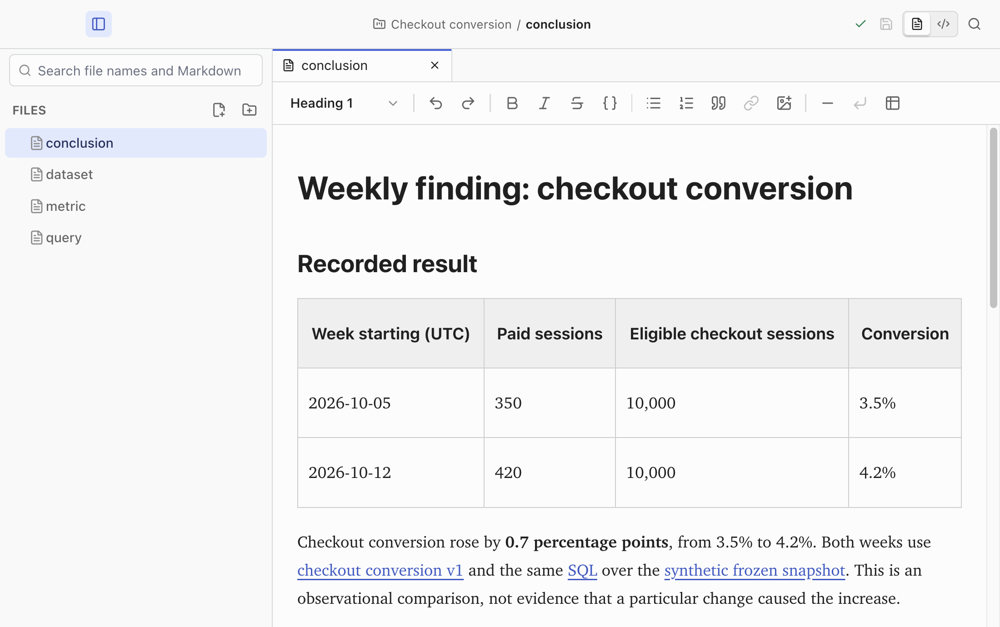

# Open Knowledge

Open Knowledge is a desktop app for keeping project notes in Markdown and sharing selected folders with an AI agent. I use it for data analysis: the SQL, the definition of a metric, and the note explaining last week's result all live in the same folder.

Open a folder to write or search, with no account or import step. Your files stay where they are. Opening a folder in the editor does **not** share it with an agent.



## Try it

The [latest release](https://github.com/WangJieFei1/OpenKnowledge/releases/latest) is source only. [Build the app](#build-from-source), click **Open folder**, and select [the checkout example](examples/checkout-conversion/workspace).

Start with the [weekly result](examples/checkout-conversion/workspace/conclusion.md): checkout conversion rose from 3.5% to 4.2%. Was that more paid sessions or fewer eligible sessions? The denominator stayed at 10,000; paid sessions went from 350 to 420. Follow the [metric definition](examples/checkout-conversion/workspace/metric.md) to see what counts as paid, then check the [SQL](examples/checkout-conversion/workspace/query.md) against the [dataset notes](examples/checkout-conversion/workspace/dataset.md). To get the same numbers yourself, [run the example in DuckDB](examples/checkout-conversion/README.md#reproduce-the-sql-result). The data is synthetic; the desktop app doesn't run SQL.

## Give an agent access to a project

In **MCP Settings**, set the example workspace to **Read** and leave your other folders **Off**. Choose **Reveal connection**, copy the configuration into a client that supports the Model Context Protocol (MCP), and keep Open Knowledge running. Try asking: “Which sessions did we exclude from checkout conversion? Show me the lines in the metric note.”

**Read & edit** also lets a connected client create and update Markdown. Switching a workspace back to **Off** closes active sessions. After reconnecting, the client no longer has access to that folder through Open Knowledge. This doesn't erase text the client has already read. All clients using the same connection see the same shared folders. [Connection and permissions](apps/open-knowledge/docs/mcp.md)

The default **General** edition doesn't read chat history. The optional **Codex** edition can also search local Codex conversations for a shared project, using the session's working directory to identify the project. This is off by default. [Edition differences](apps/open-knowledge/docs/editions.md)

## How much text goes to the agent?

For the checkout question in the [benchmark](examples/checkout-conversion/README.md#reproduce-the-count), one call returning four known passages used 1,169 tokens. Pasting all four notes used 2,134. For notes already trimmed to those passages, pasting was cheaper: 795 tokens versus 1,161 through the tool. These are local counts of the question, arguments and results, not the cost of an entire chat.

## Build from source

Use Bun 1.4.0 and Node.js 22.17 or later. On macOS, install the Xcode Command Line Tools. From the repository root:

```sh
bun install --frozen-lockfile
cd apps/open-knowledge
bun run dev
```

The first run downloads the search model. After that, search by meaning runs on your computer. A connected agent can still send the text it reads to its own provider.

[macOS folder access](apps/open-knowledge/docs/macos.md#first-launch-and-folder-access) · [Windows setup](apps/open-knowledge/docs/windows.md) · [Development and tests](apps/open-knowledge/docs/development.md) · [Workspace format](apps/open-knowledge/docs/open-knowledge-format.md) · [MIT license](LICENSE)
